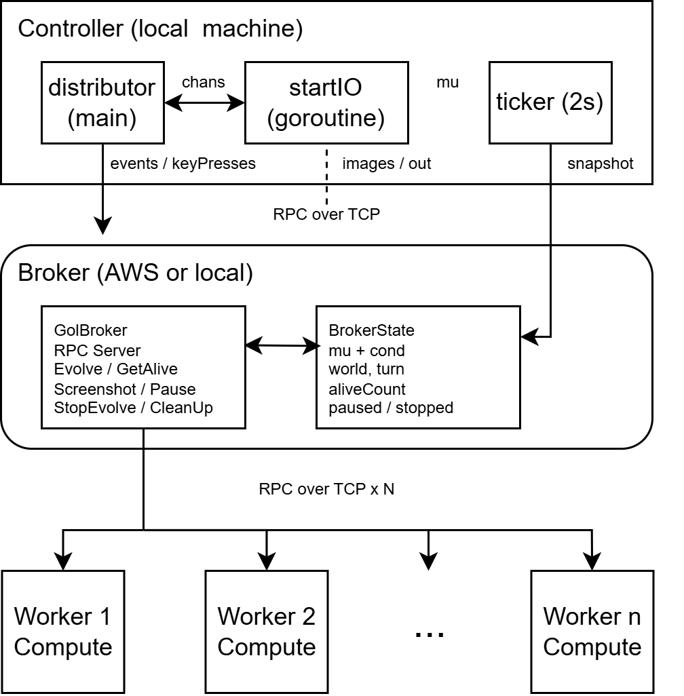
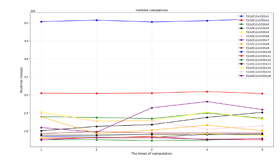
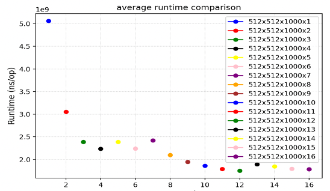

# Game of Life — Coursework Report

> **Team members:**
> - [Yanzhao Zou] - [coolcorn06]
> - [Tomoki Hara] - [Tomoki1204]
> - [Yangfan Zhou] - [Sandman26118]

---

## 1. Functionality and Design

### 1.1 Implemented functionality

A single-threaded Game of Life system is implemented first in this project. Accordingly, from the second step, the map calculation is split into multiple workers instead of calculating the whole map at once. In the third step, the system that counts all alive cells on the current map every 2 seconds was implemented. The fourth step is to implement the logic that outputs a PGM image of the world after all turns have completed. The keypress logic is implemented in the fifth stage: the “s” key is used to generate a PGM screenshot of the current world, the “q” key is for stopping the computation before saving the PGM image of the world and terminating the program, and the “p” key is to pause and resume.

### 1.2 System architecture

[Figure 1: architecture diagram — controller (`distributor`, `startIo`, ticker) ↔ broker (`GolBroker`, `BrokerState`) ↔ N × worker (`GolWorker.Compute`). Show channels and RPC arrows.]

[Since the distributor works as the controller of this game, the broker runs the main computation, and workers (AWS nodes) calculate the alive cells. When the distributor needs to place orders with the broker, it must also send the required information to the broker. The same logic can be applied to the relationship between the broker and workers.
]

### 1.3 Goroutines and how they cooperate *(Parallel)*

| Goroutine | Created by | Responsibility | Synchronisation |
|---|---|---|---|
| `distributor` (main) | `gol.Run` | Drive turns, handle keys, emit events | — |
| `startIo` | `gol.Run` | PGM read/write on request | `ioCommand`, `ioFilename`, `ioInput`, `ioOutput`, `ioIdle` |
| ticker | `distributor` | Every 2 s emit `AliveCellsCount` | `done`, `tickerStopped`, `mu`, `snapshot`, `completedTurns` |
| `worker` × `p.Threads` | `nextWorld` | Compute one horizontal band per turn | one `chan [][]uint8` per worker, closed by `wg`-style join |
| RPC batch goroutine | `distributor` (distributed) | One `evolveRemotely` call | `resultCh` |

**Worker Goroutine:**

The first go function is used in the main for loop, which calculates the board state every turn.

Instead of calculating the whole map at once, this program splits the board into multiple threads and passes each one to a different worker. Go function is utilised here.

     for i := 0; i < p.Threads; i++ { 
       startY := i * WorkerRow 
       endY := (i + 1) * WorkerRow 
       if i == p.Threads-1 { 
         endY = p.ImageHeight 
       }
       channels[i] = make(chan [][]uint8) 
       go worker(p, startY, endY, gameMap, channels[i]) 
    }

If this calls worker function without “go”, this system simply waits for worker finishing the calculation for every time, which is slower than calculating the whole map at once. However, with “go”, the worker goroutine is launched concurrently, which is faster because multiple calculations can be processed at the same time.

Once a worker finishes the calculation, it sends the results through an unbuffered channel (channels[i]). The main reason for using an unbuffered channel instead of buffered channel is that it forces the main logic to wait for a specific channel to finish processing. Otherwise, a channel can be empty or unfinished.

**Ticker Goroutine:**

Beside of main loop and *Worker goroutine*, Ticker goroutine (`time.NewTicker(2*time.Second)`) reads from `snapshot` locked (`mu.Lock()` & `mu.Unlock()`). And then sends `AliveCellsCount`. When under distributed mode, it calls `GolBroker.GetAliveCount` RPC instead.

### 1.4 Data sent over the network *(Distributed)*

| Direction | Message | When | Why |
|---|---|---|---|
| controller → broker | `EvolveRequest{World, Turns, Threads, W, H}` | once per batch | broker needs the full initial world and size |
| broker → worker | `ComputeRequest{StartY, EndY, W, H, CurrentMap}` | every turn, every worker | worker needs **full** `CurrentMap` because band boundaries read neighbours across bands |
| worker → broker | `ComputeResponse{Calc}` | after each turn | only the worker's own band is returned (saves bandwidth) |
| broker → controller | `EvolveResponse{World, CompletedTurns}` | once per batch | controller needs final world to render / write PGM |
| broker → controller | `AliveResponse{AliveCount, Turn}` | every 2 s | ticker requirement |
| controller → broker | `Pause` / `Screenshot` / `StopEvolve` / `CleanUp` | on key press | pause / save / graceful stop / kill |

[the controller <--> broker connection allows the controller start, control a computation while the broker <--> worker connection does the actual calculation. Thus, without the first connection, the program cannot be controlled and make output, and without the second connection, there is no map calculation on this program. ]

### 1.5 Key design decisions

[TODO: bullet list, 3–5 items, each one sentence + one reason. e.g.
- Row-band partitioning (not column) — sequential memory access, cache-friendly.
- RPC boundary at turn granularity — allows pause/stop between turns.
- Broker holds `BrokerState` behind one mutex — single source of truth for `world`, `turn`, `aliveCount`, `paused`.]

---

## 2. Critical Analysis

### 2.1 Implementation history *(required)*

| Stage | Description | Throughput (turns/s) | Notes |
|---|---|----------------------|---|
| S1 | Local, single-threaded (`-t 1`) | [TODO]               | baseline |
| S2 | Local, `p.Threads` workers per turn | [TODO]               | first parallel version |
| S3 | Local, channel-based pipeline | [TODO]               | [TODO: what changed vs S2] |
| S4 | Distributed, broker + N workers | [TODO]               | final |

[Figure 2: bar chart of the four stages, same `-w 512 -h 512 -turns 100` configuration.]

### 2.2 Parallel scaling *(Parallel)*

**Experiment:** The benchmark_test.go was implemented based on the gol_test.go, and these figures were generated by graph.py based on the results from benchmark_test.go.

It runs a 512x512 map, taking 1000 turns, 5 times with a different number of workers.

| Threads | average value for 5 runs (ns) | ≈ s | turns/s | Speed-up vs 1 | efficiency |
|---:|---:|---:|---:|---:|---:|
| 1 | 5.06e9 | 5.06 | 197.6 | 1.00× | 100% |
| 2 | 3.06e9 | 3.06 | 327 | 1.65× | 82% |
| 3 | 2.39e9 | 2.39 | 418 | 2.12× | 71% |
| 4 | 2.23e9 | 2.23 | 448 | 2.27× | 57% |
| 8 | 2.11e9 | 2.11 | 474 | 2.40× | 30% |
| 12 | 1.74e9 | 1.74 | 574 | 2.91× | 24% |
| 16 | 1.78e9 | 1.78 | 562 | 2.84× | 18% |

**Analysis:** As these two pictures show, as the number of workers increases, the runtime significantly decreases. However, as Figure 2 shows, the runtime seems to converge at around 1.75 to 1.9 s/op as the number of workers increases, which means the runtime can be reduced by 5.08/1.75 ≒2.89 times by splitting the map into different threads. Additionally, this figure shows that the runtime is effectively reduced when the number of threads are from 1 to 12. However, after 12 workers, the time is not affected that much, and when it comes to the figure 1, 10 to 12 threads are relatively effective. Therefore, it can be concluded that 10 to 12 workers are the most effective number that can minimise the runtime because as the number increase, the cost of the computation increase as well. Beyond 12, the per-turn goroutine/channel allocation and memory-bandwidth contention take more CPU resources, which would offset efiiciency improved by further parallelism.

Efficiency at 12 threads is only 2.89/12 = 24%, and at 16 threads 2.84/16 = 18%. This indicated that per-turn goroutine/channel allocation and shared-memory bandwidth become the primary dominant cost well before the core count is exhausted.

However, this result might be affected by the chip of the computer that runs this project.

### 2.3 Distributed scaling *(Distributed)*

**Experiment:** fixed `-w 512 -h 512 -turns 100`, `GOL_WORKERS` = 1, 2, 4, 8 workers, all on the same machine (loopback), median of 3 runs.

| Workers | turns/s | Speed-up vs 1 worker | Network bytes per run |
|---:|---:|---:|---:|
| 1 | 100 | 1.00× | 528MB |
| 2 | 189 | 1.72 | 791MB |
| 4 | 289 | 2.62 | 1.32GB |
| 8 | 246 | 2.23 | 2.37GB |

Figure 4: This is examined by running the benchmark_test.go on a M2 chip

**Analysis.** Although the network bytes increases linearly, the speed-up does not. The reason can be that since the broker sends whole map to each worker, as the number of worekers incerases more than 4, the cost becomes more than it saves by splitting the map into a separate workers. Also, all workers, controller, and broker run on a M2 chip, which has 8-core, and they compete for a core, this result can depends on the number of cores. The real AWS nodes does not have cores, but the latency from sending data through network may cost higher.

---

## 3. Fault Tolerance *(Distributed)*

| Failure                              | Current behaviour                                                                                                                                                                          | Effect on results                                                                                                              | Possible mitigation                                                                                                                |
|--------------------------------------|--------------------------------------------------------------------------------------------------------------------------------------------------------------------------------------------|--------------------------------------------------------------------------------------------------------------------------------|------------------------------------------------------------------------------------------------------------------------------------|
| One worker dies                      | Broker exits:`[Broker] worker N failed: connection is shut down`; Controller exits:`Broker call failed: connection is shut down`                                                           | **Run terminated**; `FinalTurnComplete` reports last successfully completed turn; final PGM **not written** if `quitRequested` | Detect short `next`, fall back to `nextWorld` locally for that band, or abort and report to controller                             |
| Broker dies                          | Controller exits: `Broker call failed: unexpected EOF`                                                                                                                                     | **Run terminated**; `FinalTurnComplete` reports last successfully completed turn; final PGM **not written** if `quitRequested` | Retry-dial with backoff; buffer last world in controller and write PGM anyway                                                      |
| Network partition broker ↔ worker    | Broker exits:`[Broker] worker N failed: connection is shut down`Controller exits: `broker at x.x.x.x:brokerPort failed to dial: dial tcp x.x.x.x:brokerPort: connect: connection refused` | **Run terminated**; `FinalTurnComplete` does not reports; final PGM **not written** if `quitRequested`                         | Same as above                                                                                                                      |
| Network partition controller ↔ broker | The controller stucks, key presses has no respond                                                                                                                                          | Truncated run                                                                                                                  | Make controller get in touch with broker by sending signal each other continuously. Broker kills all remote tasks if disconnected. |

**Trade-offs:** The current design is *fail-fast* rather than *fault-tolerant*: it never silently returns a wrong answer, but it also does not recover.]

---

## 4. Scaling with More Distributed Components *(Distributed)*

Adding workers divides the computation. Thus it can grow the time per turn. However, each worker recieves the entire map, so that each turn it must wait for the solwest worker to finish computation. As a result, as extra workers are added, the speed up get flat, and too many workers may cost more than it saves. In addition to it, the broker handles all workers, so even if one worker goes to failure, since there is no timeout logic herem the broker waits forever. Also, as the number of threads increases, the cpu gets buisier and the total runtime gets slower. 

---

## 5. Methodology *(both sections)*

- **Hardware:** M2 chip MacBook: an 8-core CPU (4 peformance + 4 efficiency).
- **Environment:** **OS**: MacOS: Tahoe 26.5
-  benchmark ran the full gol.Run pipeline on the 512×512 image for 1000 turns, including PGM input/output and event handling, with SDL disabled and all events drained.
-  For the parallel implementation, the benchmark run with from 1 to 16 threads for 5 times each.
-  for the distributed implementation, the benchmark run with from 1 to 8 workers for 3 times each.
-  Network traffic: calculated by gob-encoding the actual ComputeRequest/ComputeResponse messages and multiplying by the number of workers and turns.
-  Tool: Go's benchwork framework
-  go version: go1.27.1 darwin/arm64

---

## 6. Conclusion *(optional, ≤ 4 sentences if space allows)*
